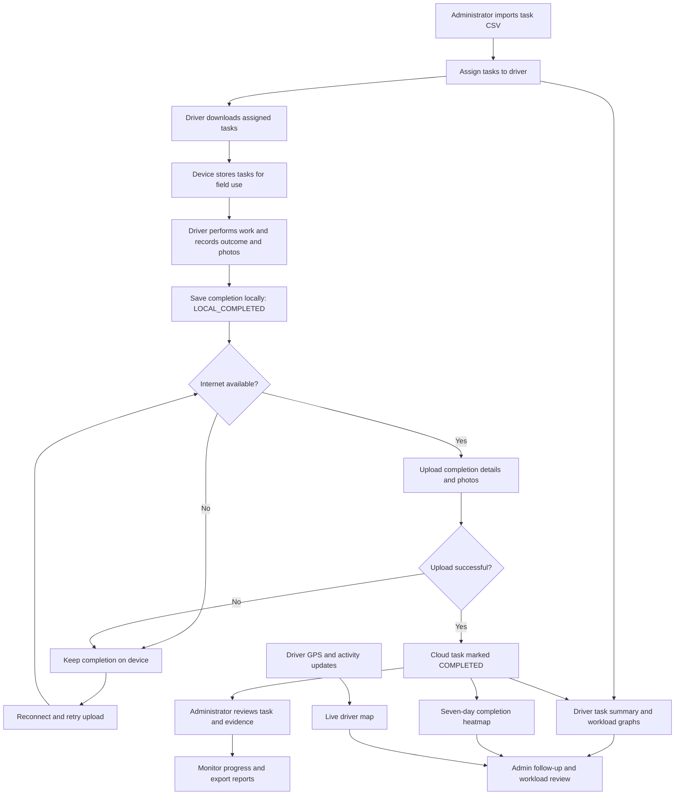

# NSCA system flow

Current presentation: `nsca-system-presentation-v5.pptx` contains eleven slides. Slide 11 explains how Task Viewer works. Rebuild with `python presentation/taskSystem/build_system_presentation.py nsca-system-presentation-v5.pptx`.

Latest version: `nsca-system-presentation-v4.pptx` contains ten slides, including the Task Viewer visibility flowchart on slide 10. Rebuild with `python presentation/taskSystem/build_system_presentation.py nsca-system-presentation-v4.pptx`. The standalone flowchart is `taskviewer-flow.svg`.

Latest PowerPoint including the Task Viewer usage guide: `nsca-system-presentation-v3.pptx` (nine slides). Rebuild with `python presentation/taskSystem/build_system_presentation.py nsca-system-presentation-v3.pptx` from the project root.

Previous PowerPoint with the Admin/Driver overview: `nsca-system-presentation-v2.pptx`. To rebuild this version, run `python presentation/taskSystem/build_system_presentation.py nsca-system-presentation-v2.pptx` from the project root. The original PowerPoint was retained because it could not be overwritten.

PowerPoint version: `nsca-system-presentation.pptx` was originally created with seven widescreen slides with editable text and flowchart shapes. From the project root, run `python presentation/taskSystem/build_system_presentation.py` to rebuild it from the HTML presentation and SVG flowcharts.

Presentation companion to `system-flow-presentation.html`. Open the HTML in a browser to present nine slides or print them to PDF in landscape orientation. Slide 5 contains the complete visual flowchart, also available as `system-flow.svg` for use in presentation software. Slide 6 covers the driver app features. Slide 7 shows the driver workflow, also available as `driver-app-flow.svg`.

## Presenter notes

1. **Main flow:** Administrators import tasks and assign drivers. Drivers download their work, visit the locations, record results, and upload completions. Administrators then monitor and report on the shared records.
2. **Roles:** Firestore holds shared task records, Firebase Storage holds uploaded photos, and Realtime Database receives driver location updates. IndexedDB supports local task storage. Field work should be downloaded before going offline.
3. **Offline completion:** Saving work locally does not yet complete the shared cloud record. The device retains unsent work until successful transfer. Saved JSON completion backups and recovery tools provide an additional recovery path.
4. **Monitoring:** The live map shows reported driver locations, activity indicators, and access to open tasks. The driver summary table and stacked workload graph compare For Download, Pending, and Completed tasks. The hourly graph groups completions in Philippine time. The seven-day heatmap compares completion percentages by driver and task-created date, with period navigation, refresh, and BA/job-type filtering.
5. **System graph:** Follow the top row from import to local completion. The connectivity decision routes work to upload or local retention and retry. Shared task records feed summary graphs, the heatmap, and evidence/report views; GPS and activity updates separately feed the live map. Administrators use these views to follow up and review workloads.

### Monitoring details

- **Live map:** Activity is Active when the latest update is under one minute old, Idle from one to under two minutes, and Offline after that; a missing update is Unknown. Location updates depend on GPS and connectivity.
- **Summary graphs:** Use locally cached task records; sync to fetch changes. Workload bars show status counts, while the hourly chart uses recorded completion timestamps, including corrected timestamps where available.
- **Heatmap:** The latest period ends yesterday. Older days use report snapshots; yesterday is checked live. Cells show rounded completed / total percentages for tasks created on each date, rather than the number of tasks performed that day. Gray means no tasks, red below 50%, amber 50–79%, light green 80–99%, and green 100%.
- **Presentation graphics:** Workload bars and heatmap values on slide 4 are illustrative, rather than connected dashboard data.

### Driver app features — slide 6

- **Assignment download:** Validate the driver ID, select a date, download assigned tasks, and view task counters.
- **Search and filtering:** Search tasks, filter by date and job type, and scan QR codes to find a matching task.
- **Task map:** Explore task markers and clusters, return to the task list, and center on the driver's location. GPS status and location updates support admin visibility when available.
- **Field completion:** Review customer/job details, complete configured fields, capture supporting photos, and submit the result locally.
- **Offline storage:** Previously downloaded tasks, completion details, and photos remain on the device for field use and later upload. Offline task access does not guarantee offline map tiles.
- **Transfer and recovery:** Sync completed tasks, inspect progress and success/failure counts, retry pending uploads, and use saved completion backups for recovery.

Presenter explanation: “The driver app brings the assigned task list, task map, field evidence, offline saving, and completion upload into one workspace. Drivers download before field work and sync their saved results when connected.”

### Driver app flow — slide 7

Validate driver ID → Select date and download assignments → Find task using search, filters, or meter QR → View details/map and visit customer → Perform work → Record completion fields and photos → Submit and save locally → Sync completed tasks when connected → Successful cloud completion → Continue with next task or finish the day.

If offline or upload fails, retain the saved completion on the device, reconnect, and retry. Saving locally and uploading successfully are separate stages; administrators see the shared completion after transfer.

## Implementation references

- `assign.html`: CSV task import and driver assignment.
- `driver.html`: driver ID validation, downloaded tasks, maps, photo capture, local completion, and upload/recovery handling.
- `admin.html`: live driver map and activity, driver summary table, workload and hourly completion graphs, seven-day completion heatmap, completion evidence, and administrative corrections.
- `report.html`: filtered task report export.
- `upload-task.html`: completion recovery and upload tools.

The diagram summarizes the main task workflow; it does not cover the separate payroll module or every administrative maintenance action. Connectivity and upload decisions describe operational behavior, rather than promising an automatic retry schedule.

### High-level Admin and Driver flow - slide 8

Admin: Import tasks -> Assign drivers -> Monitor operations -> Review evidence and export reports.

Driver: Download assignments -> Find and visit tasks -> Record outcome and photos locally -> Sync completed work.

Assignments connect Admin to Driver. GPS/activity updates feed admin monitoring when available, and successful uploads feed admin review. Offline or failed uploads remain on the device for retry. The visual is available as admin-driver-high-level-flow.svg.

### How to use Task Viewer — slide 9

1. Open `login-taskview.html` on the hosted system. Enter your registered email and password and click **Login**. The account must be active in the Task Viewer configuration and have appropriate BA assignments.
2. Select the **From** and **To** dates. These retrieve tasks by assigned date, not necessarily the date on which the task was completed. Wait while the loading indicator retrieves records.
3. Use **Search** to find a customer, meter, account, or driver. Select the available **BA** checkboxes to narrow results. Only configured BAs within your account's assigned access are shown.
4. Click a task's customer header to expand it. Review customer/address details, the assigned driver, completion time, and configured completion fields. Click again to collapse.
5. Click **Load Photos** inside the expanded record to view uploaded evidence. **No photos** means no photo URLs were available for that record.
6. Use **Prev** and **Next** to browse pages. The page indicator shows the result count. Click **Logout** when finished.

If no tasks appear, check the selected dates, clear the search, and review BA filters. If expected records remain missing, ask the Task Viewer administrator to check your BA access and whether the tasks have been uploaded as completed. Task details in this viewer are read-only. Task Viewer admins additionally see **Config** for managing viewer settings; regular viewers do not need it for review.

Implementation references: `login-taskview.html` for sign-in; `taskview.html` for role/BA access, date selection, search, detail expansion, photos, pagination, and logout.

### Task Viewer visibility flow — slide 10

Successful completion upload → Shared completed record. Separately, sign in → Verify active Task Viewer role and assigned BA access → Select assigned-date range → Load cached snapshots, check snapshot updates, and query completed Firestore records → Combine records → Apply configured BA/user BA access and search filters → Show matching task cards → Expand details and load photos.

Cached snapshot records can appear before the background database check finishes. Live Firestore reads are scoped to completed tasks, selected assigned dates, and allowed configured BAs. Results combine snapshot and live records; the viewer applies BA access and search filters before display. This is a load-and-check workflow, not a promise that every new completion appears continuously without reloading.

### How Task Viewer works — slide 11

The system checks the signed-in user's active viewer/admin role and assigned BAs. For the selected assigned-date range, it first loads saved snapshots from browser storage. In the background it checks published snapshots for changes and queries completed Firestore tasks within allowed configured BAs. It merges records by task ID, giving live records precedence over matching snapshots, and applies BA access, selected BA filters, and search before rendering task cards and pagination.

Expanded cards show read-only task information and configured completion fields. Photos load only when requested, using the task's recorded photo links; older records without links use a legacy database lookup. Clicking a photo thumbnail opens the image. Cached results can remain available if a background read fails, so an early visible result list does not itself mean every database check has finished.
